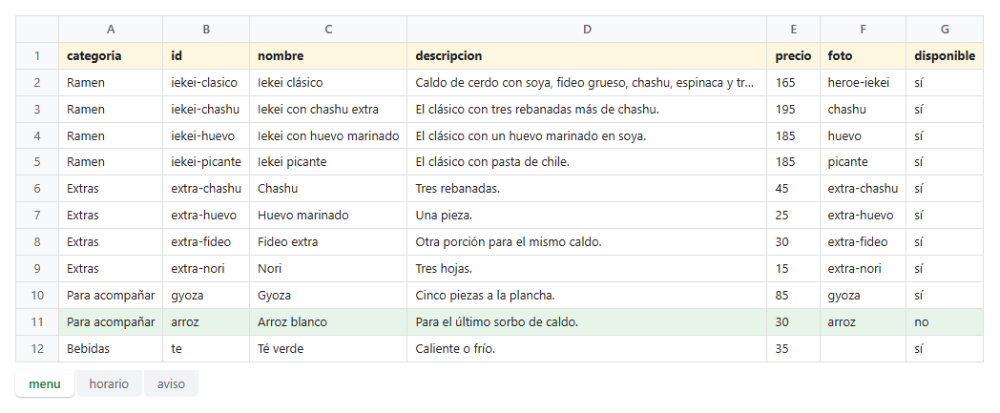
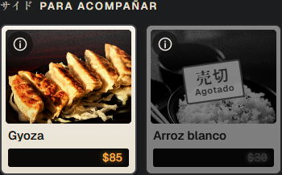
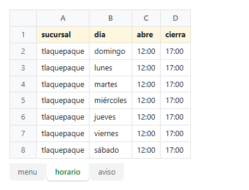
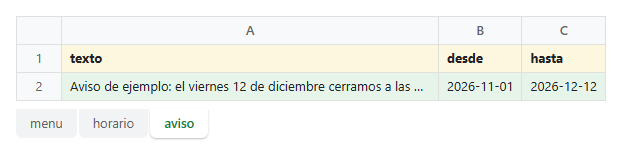
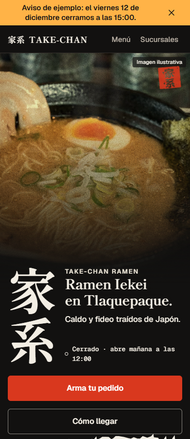

# Cómo cambiar el menú, el horario y los avisos

Para el equipo de Take-chan Ramen. Todo se cambia desde una hoja de cálculo de Google, en la computadora o en el celular (app Hojas de cálculo de Google). No hace falta llamar a nadie.

**Cuándo se ve el cambio:** en unos minutos. Quien ya tenía el sitio abierto lo verá a más tardar en 10 minutos o al recargar la página. Si la hoja no responde, el sitio sigue mostrando el último menú publicado.

La hoja tiene tres pestañas, abajo: **menu**, **horario** y **aviso**. No cambies los títulos de la fila 1 ni el orden de las columnas.

---

## Cambiar un precio
1. Abre la pestaña **menu**.
2. Busca el platillo en la columna **nombre**.
3. Escribe el precio nuevo en la columna **precio**, solo el número: `175` (sin el signo de pesos).

## Marcar un platillo como agotado
1. En la pestaña **menu**, columna **disponible**, escribe `no`.
2. En el sitio, la tecla de ese platillo se apaga con el letrero **売切 Agotado** (como en las máquinas de Japón) y no se puede pedir.
3. Cuando vuelva a haber, escribe `sí`.

## Agregar o quitar un platillo
- **Agregar:** escribe una fila nueva debajo de los de su categoría. Llena categoría, nombre, descripción y precio. La columna **id** puede quedar vacía; la columna **foto** también (se ve sin foto hasta que se agregue una).
- **Quitar:** borra la fila completa. Si solo se acabó por hoy, mejor márcalo como agotado.
- El orden de las filas es el orden en que aparecen en el sitio.

## Cambiar el horario
1. Abre la pestaña **horario**. Hay una fila por día y por sucursal.
2. Escribe la hora en formato de 24 horas: `12:00`, `17:30`.
3. **Día de descanso:** deja vacías **abre** y **cierra** en ese día.

El "Abierto ahora · cierra en…" del sitio usa este horario.

## Poner un aviso ("Hoy cerramos a las 15:00")
1. Abre la pestaña **aviso**.
2. En **texto**, escribe el aviso tal como quieres que se lea. Corto: una línea.
3. En **desde** y **hasta**, las fechas en formato año-mes-día: `2026-12-12`. Si quieres una hora exacta: `2026-12-12 15:00`.
4. El aviso sale en una banda amarilla arriba del sitio solo entre esas fechas. Después desaparece solo.

Para quitar un aviso antes de tiempo, borra su fila. Quien ya lo cerró con la ✕ no lo vuelve a ver.

---

## Si algo no se ve bien
- **Revisa la fila 1:** los títulos deben seguir iguales (`categoria`, `id`, `nombre`, `descripcion`, `precio`, `foto`, `disponible`).
- **Precios:** solo números, sin `$` ni letras.
- **Horas:** con dos puntos (`12:00`), no `12 hrs`.
- Si el sitio no toma los cambios después de 10 minutos, avísale a quien te hizo el sitio.

---

Para quien mantiene el sitio: cómo se conecta la hoja

1. Crear una hoja de Google con tres pestañas, `menu`, `horario` y `aviso`, copiando el contenido de `sitio/public/datos-ejemplo/*.csv`. Los CSV se generan con `node herramientas/hoja-ejemplo.mjs`.
2. En la hoja: *Archivo → Compartir → Publicar en la Web*, elegir cada pestaña y el formato **CSV**, y copiar las tres URL.
3. Pegarlas en `sitio/src/entornos/entorno.oficial.ts` → `hoja: { menu, horario, aviso }` y volver a publicar (`GUIA_PUBLICAR.md`).
4. Cómo se comporta: el sitio lee la hoja al abrir y espera hasta 3 s. Guarda una copia por 10 minutos en el navegador y, si la hoja falla, usa la última copia o los JSON del build. El prerender (y Google) siempre ven los JSON del build, así que conviene pasar ahí los cambios grandes de vez en cuando.
5. Prueba: `node herramientas/hoja.mjs` contra el ensayo oficial (agotado, precio, falla, espera, copia guardada, aviso vigente y vencido, horario).

