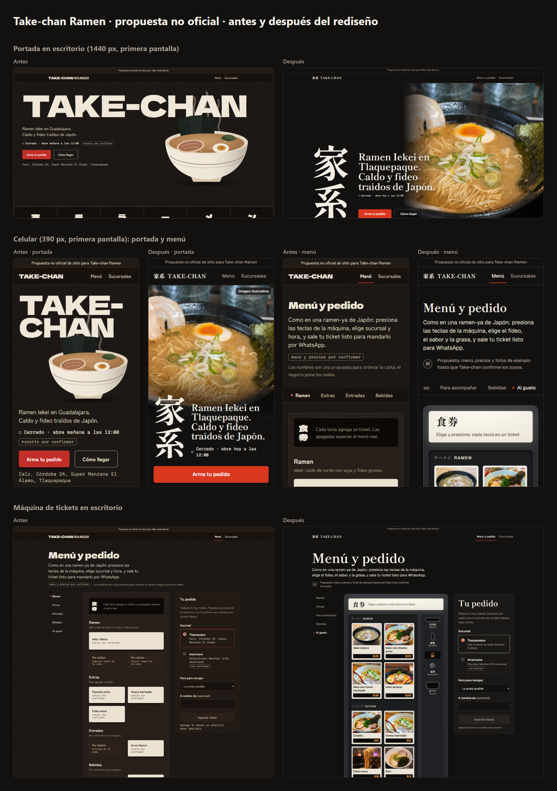

# Progreso · Take-chan Ramen (propuesta no oficial)

- **Pages:** https://andre-bhp.github.io/Take-chan/
- **Repositorio:** https://github.com/Andre-BHP/Take-chan
- **Última subida:** 2026-11-16 10:40 (hora de Guadalajara)

## Rediseño (2026-11-15)
André revisó la primera versión: "quedó muy feo y muy mal". Este rediseño cambia la dirección a "una ramen-ya de Yokohama de noche": fotos de ejemplo rotuladas, negro sumi y papel washi, 家系 vertical y un solo acento bermellón.

- [x] R0. Capturas de "antes"
- [x] R1. `DESIGN.md` nuevo y wireframe gris de inicio y menú
- [x] R2. Fotos de Unsplash (AVIF y WebP en 3 tamaños, blurhash) y créditos
- [x] R3. Tipografías, tokens y portada nueva
- [x] R4. `/menu` con una máquina de tickets de verdad
- [x] R5. Sucursales y pie
- [x] R6. Revisión de impeccable y design-taste-frontend, y correcciones
- [x] R7. Pruebas, comparativa antes y después, mockups de visita
- [ ] R8. Reporte

## Primera versión (pasos 0 a 9, terminada)
Repositorio, Pages, datos, inicio, máquina de tickets, sucursales con JSON-LD, pruebas y lista para el negocio. Capturas en `entregables/avances/antes/`.

## Último paso
**R7.** Pruebas en verde ([`entregables/pruebas.txt`](entregables/pruebas.txt)): axe sin violaciones en las 4 páginas a 390 y 1440 px; sin scroll horizontal a 360 (y a 320) px; portada de 420 KB con fotos AVIF; LCP de 1.4 s con 4G lenta y CPU 4x; con movimiento reducido no hay vapor ni ticket deslizándose. Comparativa en [`entregables/avances/comparativa.png`](entregables/avances/comparativa.png), capturas a 360, 390 y 1440 en [`entregables/capturas/`](entregables/capturas/) y mockups de visita nuevos en [`entregables/capturas-visita/`](entregables/capturas-visita/). `DESIGN.md` con lo que quedó construido.

## Sigue
R8: reporte a André.

## Capturas más recientes
| Antes y después |
|---|
|  |
