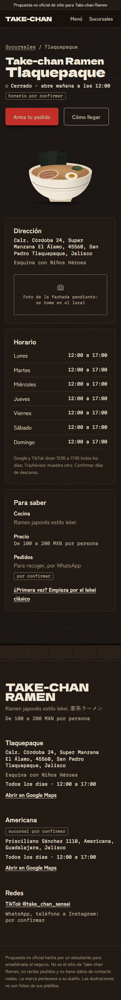
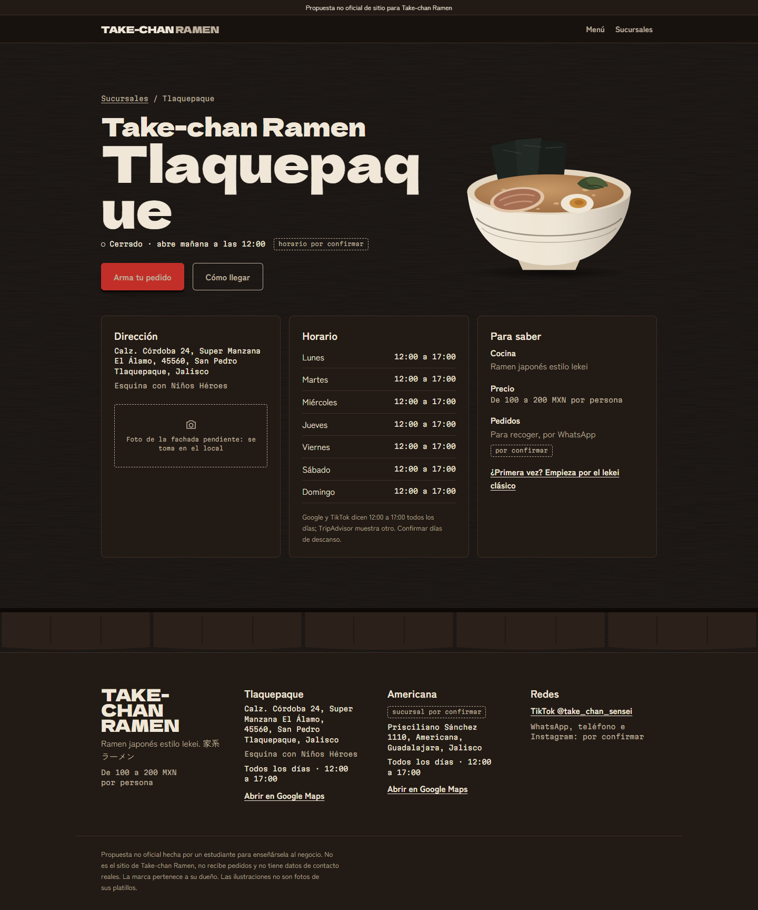
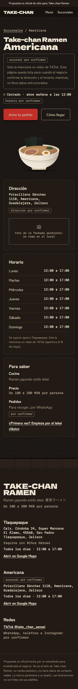

# Progreso · SENSEI (Take-chan Ramen)

Propuesta no oficial de sitio para Take-chan Ramen.

- **Pages:** https://andre-bhp.github.io/SENSEI/
- **Repositorio:** https://github.com/Andre-BHP/SENSEI
- **Última subida:** 2026-11-15 23:20 (hora de Guadalajara)

## Pasos
- [x] 0. Repositorio, Pages "en construcción" (aviso y `noindex`) y este archivo
- [x] 1. Leer fuentes
- [x] 2. `DESIGN.md` con impeccable
- [x] 3. Datos (`negocio.json` y `menu.json`)
- [x] 4. Inicio
- [x] 5. Menú y máquina de tickets
- [x] 6. Sucursales y JSON-LD
- [ ] 7. Pruebas, axe y capturas
- [ ] 8. Entregables
- [ ] 9. Push y Pages final

## Último paso
**Paso 6.** `/tlaquepaque` y `/americana` con estado "abierto ahora", horario por día, dirección, hueco para la foto de la fachada y "Cómo llegar". JSON-LD `Restaurant` en Tlaquepaque (y en el inicio) con los mismos datos que se ven en pantalla. La Americana queda marcada "por confirmar" y **sin** JSON-LD hasta que el negocio la confirme.

## Sigue
Paso 7: pruebas, axe, rendimiento y capturas.

## Capturas más recientes
| Tlaquepaque 360 px | Tlaquepaque 1440 px | Americana 360 px |
|---|---|---|
|  |  |  |
