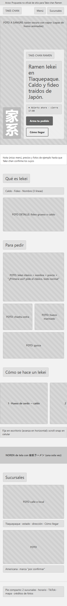
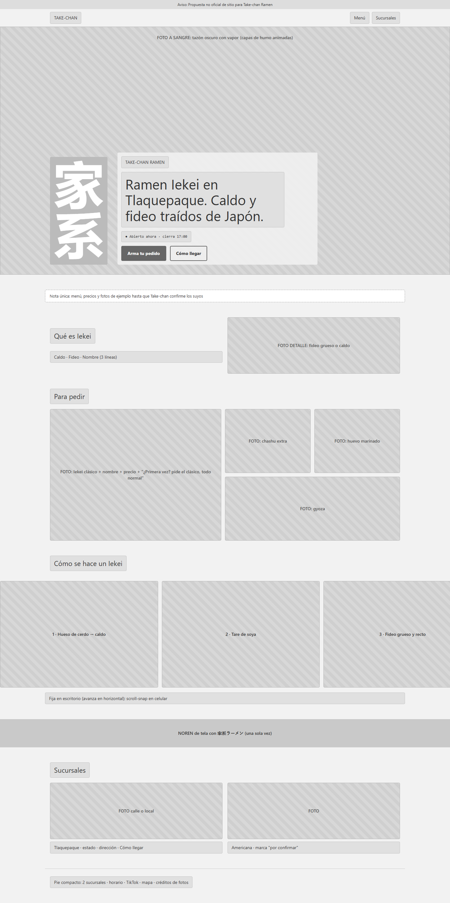
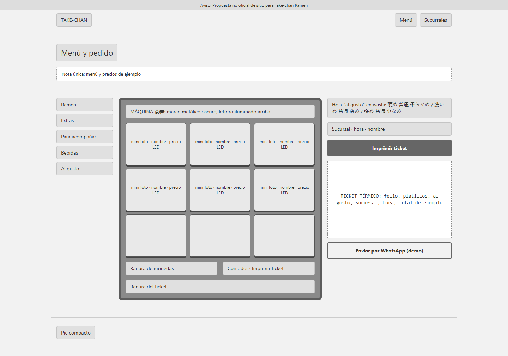

# Progreso · Take-chan Ramen (propuesta no oficial)

- **Pages:** https://andre-bhp.github.io/Take-chan/
- **Repositorio:** https://github.com/Andre-BHP/Take-chan
- **Última subida:** 2026-11-15 23:44 (hora de Guadalajara)

## Rediseño (2026-11-15)
André revisó la primera versión: "quedó muy feo y muy mal". Este rediseño cambia la dirección a "una ramen-ya de Yokohama de noche": fotos de ejemplo rotuladas, negro sumi y papel washi, 家系 vertical y un solo acento bermellón.

- [x] R0. Capturas de "antes"
- [x] R1. `DESIGN.md` nuevo y wireframe gris de inicio y menú
- [ ] R2. Fotos de Unsplash (AVIF y WebP en 3 tamaños, blurhash) y créditos
- [ ] R3. Tipografías, tokens y portada nueva
- [ ] R4. `/menu` con una máquina de tickets de verdad
- [ ] R5. Sucursales y pie
- [ ] R6. Revisión de impeccable y design-taste-frontend, y correcciones
- [ ] R7. Pruebas, comparativa antes y después, mockups de visita
- [ ] R8. Reporte

## Primera versión (pasos 0 a 9, terminada)
Repositorio, Pages, datos, inicio, máquina de tickets, sucursales con JSON-LD, pruebas y lista para el negocio. Capturas en `entregables/avances/antes/`.

## Último paso
**R1.** [`DESIGN.md`](DESIGN.md) nuevo: sumi, washi y un solo acento bermellón; Shippori Mincho B1 para 家系 vertical y títulos, Geist para texto, Geist Mono solo en horario y precios. Wireframe gris de inicio y menú en [`wireframe/`](wireframe/) (dis-064), con el orden nuevo: héroe con foto y vapor, qué es Iekei, bento con fotos, cómo se hace un Iekei en horizontal, noren, sucursales y pie compacto; y en `/menu` la máquina de metal con teclas con foto, la hoja "al gusto" y el ticket.

## Sigue
R2: fotos de Unsplash, AVIF y WebP en 3 tamaños, y créditos.

## Capturas más recientes
| Wireframe inicio 360 | Wireframe inicio 1440 | Wireframe menú 1440 |
|---|---|---|
|  |  |  |
