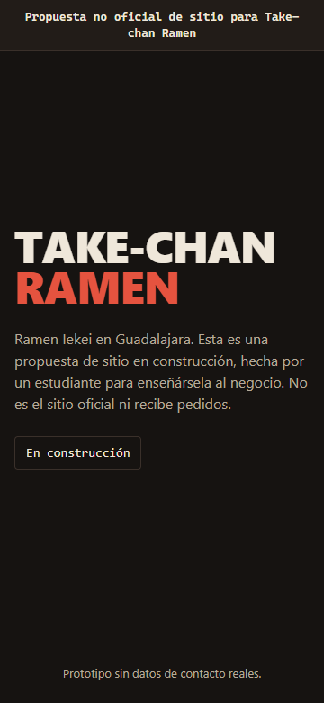
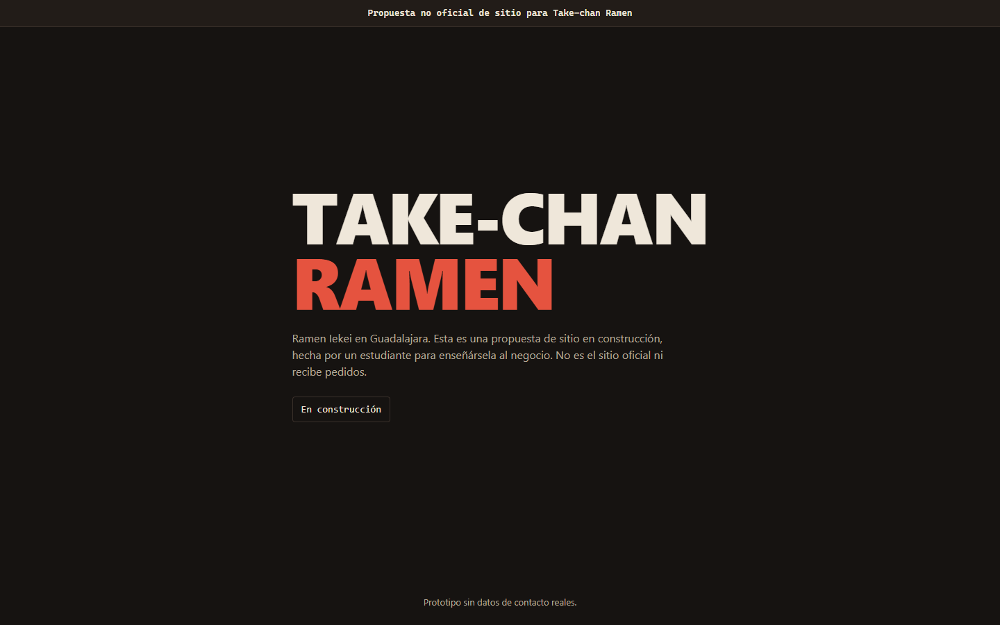

# Progreso · SENSEI (Take-chan Ramen)

Propuesta no oficial de sitio para Take-chan Ramen.

- **Pages:** https://andre-bhp.github.io/SENSEI/
- **Repositorio:** https://github.com/Andre-BHP/SENSEI
- **Última subida:** 2026-11-15 23:05 (hora de Guadalajara)

## Pasos
- [x] 0. Repositorio, Pages "en construcción" (aviso y `noindex`) y este archivo
- [x] 1. Leer fuentes
- [ ] 2. `DESIGN.md` con impeccable
- [ ] 3. Datos (`negocio.json` y `menu.json`)
- [ ] 4. Inicio
- [ ] 5. Menú y máquina de tickets
- [ ] 6. Sucursales y JSON-LD
- [ ] 7. Pruebas, axe y capturas
- [ ] 8. Entregables
- [ ] 9. Push y Pages final

## Último paso
**Paso 1.** Fuentes leídas (auditoría y plan de HERA, consulta de Arthemis, Arleth y 18 cartas de Gambit). Resumen de lo confirmado y lo que no en [`entregables/fuentes.md`](entregables/fuentes.md). Sin cambio visual.

## Sigue
Paso 2: `DESIGN.md` con tokens (impeccable).

## Capturas más recientes
| 360 px | 1440 px |
|---|---|
|  |  |
