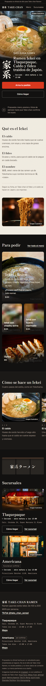
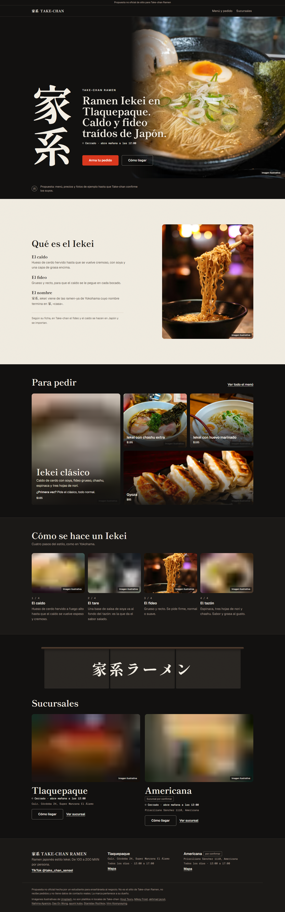

# Progreso · Take-chan Ramen (propuesta no oficial)

- **Pages:** https://andre-bhp.github.io/Take-chan/
- **Repositorio:** https://github.com/Andre-BHP/Take-chan
- **Última subida:** 2026-11-16 00:01 (hora de Guadalajara)

## Rediseño (2026-11-15)
André revisó la primera versión: "quedó muy feo y muy mal". Este rediseño cambia la dirección a "una ramen-ya de Yokohama de noche": fotos de ejemplo rotuladas, negro sumi y papel washi, 家系 vertical y un solo acento bermellón.

- [x] R0. Capturas de "antes"
- [x] R1. `DESIGN.md` nuevo y wireframe gris de inicio y menú
- [x] R2. Fotos de Unsplash (AVIF y WebP en 3 tamaños, blurhash) y créditos
- [x] R3. Tipografías, tokens y portada nueva
- [ ] R4. `/menu` con una máquina de tickets de verdad
- [ ] R5. Sucursales y pie
- [ ] R6. Revisión de impeccable y design-taste-frontend, y correcciones
- [ ] R7. Pruebas, comparativa antes y después, mockups de visita
- [ ] R8. Reporte

## Primera versión (pasos 0 a 9, terminada)
Repositorio, Pages, datos, inicio, máquina de tickets, sucursales con JSON-LD, pruebas y lista para el negocio. Capturas en `entregables/avances/antes/`.

## Último paso
**R3.** Portada nueva: foto a sangre del tazón con vapor animado, 家系 vertical en Shippori Mincho, una frase, "Abierto ahora" y un solo botón bermellón. Nota única de datos de ejemplo. "Qué es el Iekei" en papel washi con foto. Bento con fotos (clásico grande con "¿Primera vez?" integrado, chashu, huevo y gyoza; la foto se acerca al pasar el cursor). "Cómo se hace un Iekei" en 4 pasos con scroll horizontal (fijo en escritorio, deslizable en celular). Noren de tela con 家系ラーメン una sola vez. Sucursales con foto. Pie compacto con créditos. axe sin violaciones en la portada; 380 KB y LCP de 2.3 s con 4G lenta.

## Sigue
R4: `/menu` con la máquina de tickets de metal, teclas con foto y precio LED, hoja "al gusto" en washi y ticket térmico.

## Capturas más recientes
| Portada 360 | Portada 1440 |
|---|---|
|  |  |
