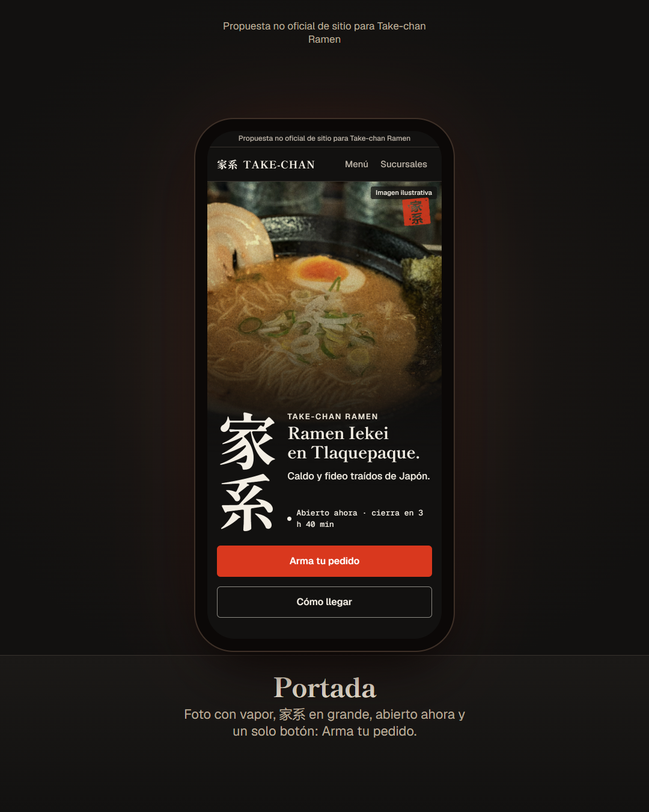
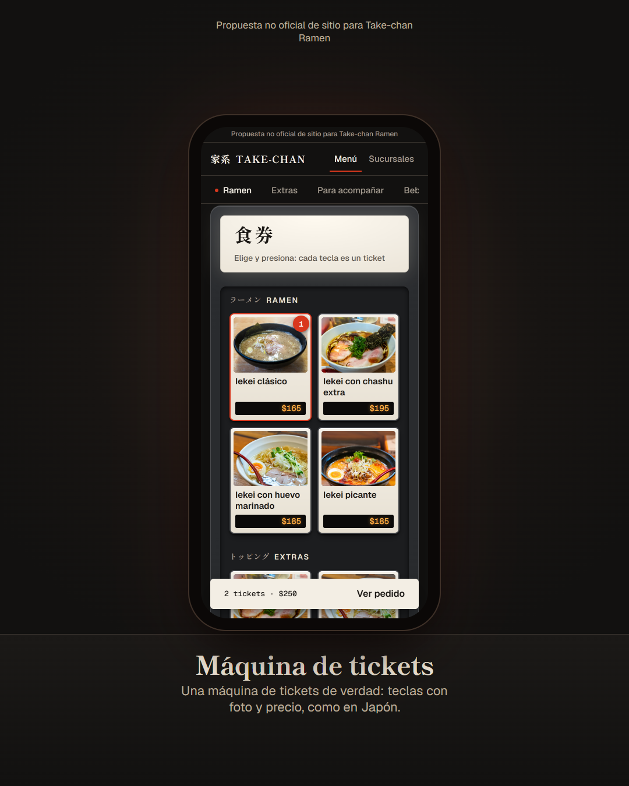
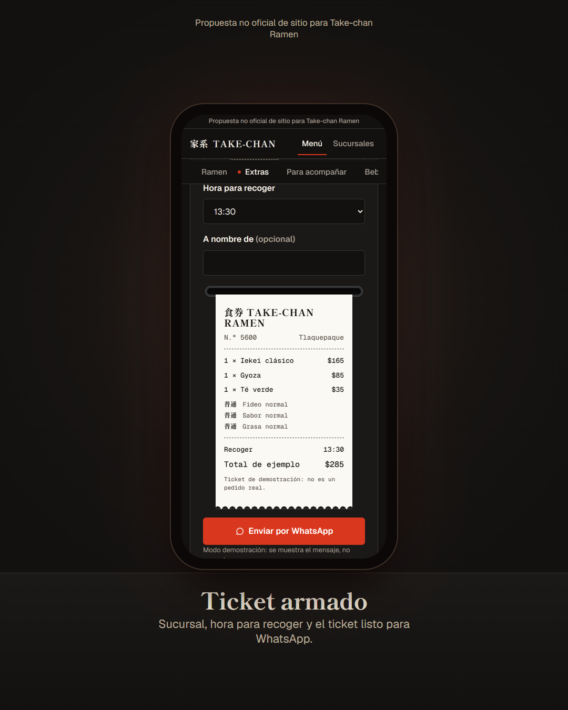

# Progreso · SENSEI (Take-chan Ramen)

Propuesta no oficial de sitio para Take-chan Ramen.

- **Pages:** https://andre-bhp.github.io/Take-chan/ (activo y verificado)
- **Repositorio:** https://github.com/Andre-BHP/Take-chan
- **Última subida:** 2026-11-15 23:34 (hora de Guadalajara)

## Pasos
- [x] 0. Repositorio, Pages "en construcción" (aviso y `noindex`) y este archivo
- [x] 1. Leer fuentes
- [x] 2. `DESIGN.md` con impeccable
- [x] 3. Datos (`negocio.json` y `menu.json`)
- [x] 4. Inicio
- [x] 5. Menú y máquina de tickets
- [x] 6. Sucursales y JSON-LD
- [x] 7. Pruebas, axe y capturas
- [x] 8. Entregables
- [x] 9. Push y Pages final

## Último paso
**Paso 9.** Revisión final de diseño (impeccable) y arreglos: noren de tela con 家系ラーメン, "horario por confirmar" también en el pie, sin rótulo encima del título, teclas "Por definir" legibles y pestañas del menú que siguen al scroll en celular. [`DESIGN.md`](DESIGN.md) reescrito según lo construido. axe, peso y LCP siguen en orden ([`entregables/pruebas.txt`](entregables/pruebas.txt)). Pages verificado en línea: HTTP 200 en las 4 páginas, aviso y `noindex` presentes, axe sin violaciones, portada de 157 KB y LCP de 1.4 s con 4G lenta.

## Sigue
1. Visita al local con [`entregables/PEDIR_AL_NEGOCIO.md`](entregables/PEDIR_AL_NEGOCIO.md) y las [capturas de visita](entregables/capturas-visita/).
2. Con lo que dé el negocio: llenar `negocio.json` y `menu.json`, tomar las fotos y quitar los "por confirmar".

## Capturas más recientes
| Visita: portada | Visita: máquina | Visita: ticket |
|---|---|---|
|  |  |  |
