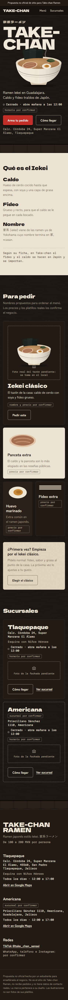
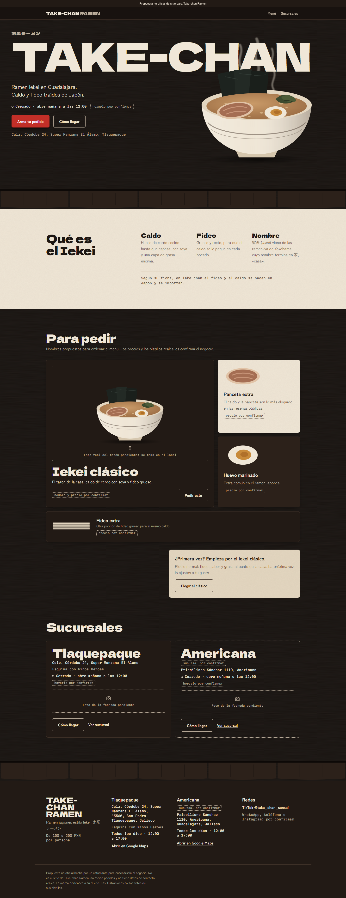

# Progreso · SENSEI (Take-chan Ramen)

Propuesta no oficial de sitio para Take-chan Ramen.

- **Pages:** https://andre-bhp.github.io/Take-chan/ (falta activarlo: Settings → Pages → rama `gh-pages`)
- **Repositorio:** https://github.com/Andre-BHP/Take-chan
- **Última subida:** 2026-11-15 23:23 (hora de Guadalajara)

## Pasos
- [x] 0. Repositorio, Pages "en construcción" (aviso y `noindex`) y este archivo
- [x] 1. Leer fuentes
- [x] 2. `DESIGN.md` con impeccable
- [x] 3. Datos (`negocio.json` y `menu.json`)
- [x] 4. Inicio
- [x] 5. Menú y máquina de tickets
- [x] 6. Sucursales y JSON-LD
- [x] 7. Pruebas, axe y capturas
- [ ] 8. Entregables
- [ ] 9. Push y Pages final

## Último paso
**Paso 7.** Pruebas con `herramientas/pruebas.mjs` (resultado en [`entregables/pruebas.txt`](entregables/pruebas.txt)): axe sin violaciones en las 4 páginas a 390 y 1440 px; sin scroll horizontal a 360 px; portada de 156 KB transferidos; LCP de 0.8 s con 4G lenta y CPU 4 veces más lenta; el vapor se anima normalmente y queda quieto con movimiento reducido. Capturas de todas las páginas a 360, 390 y 1440 px en [`entregables/capturas/`](entregables/capturas/).

## Sigue
Paso 8: `PEDIR_AL_NEGOCIO.md` y capturas para la visita en mockup de celular.

## Capturas más recientes
| Inicio 360 px | Inicio 1440 px |
|---|---|
|  |  |
