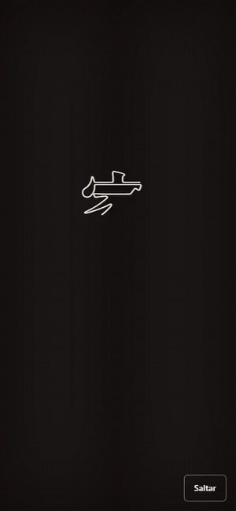

# Progreso · Take-chan Ramen (propuesta no oficial)

- **Pages:** https://andre-bhp.github.io/Take-chan/
- **Repositorio:** https://github.com/Andre-BHP/Take-chan
- **Última subida:** 2026-11-16 10:54 (hora de Guadalajara)

## Rediseño (2026-11-15)
André revisó la primera versión: "quedó muy feo y muy mal". Este rediseño cambia la dirección a "una ramen-ya de Yokohama de noche": fotos de ejemplo rotuladas, negro sumi y papel washi, 家系 vertical y un solo acento bermellón.

- [x] R0. Capturas de "antes"
- [x] R1. `DESIGN.md` nuevo y wireframe gris de inicio y menú
- [x] R2. Fotos de Unsplash (AVIF y WebP en 3 tamaños, blurhash) y créditos
- [x] R3. Tipografías, tokens y portada nueva
- [x] R4. `/menu` con una máquina de tickets de verdad
- [x] R5. Sucursales y pie
- [x] R6. Revisión de impeccable y design-taste-frontend, y correcciones
- [x] R7. Pruebas, comparativa antes y después, mockups de visita
- [x] R8. Reporte

## Movimiento (2026-11-16)
André: "mejor animación, más transiciones, mejor diseño, mejor todo". Metáfora: entrar a la ramen-ya apartando la noren. Cada paso con video (MP4) y GIF en `entregables/avances/video/`.

- [x] M0. Tokens de movimiento, Lenis y GSAP (solo en navegador), reduced-motion y grabación de video
- [x] M1. Intro de la noren y transición entre páginas
- [ ] M2. Héroe a sangre, titular por líneas, 家系 con trazo y paralaje
- [ ] M3. Washi rasgado, "Qué es el Iekei", prueba social y bento con la transición hacia `/menu`
- [ ] M4. Medidor del tazón en "Cómo se hace", sucursales y noren final de tela
- [ ] M5. `/menu` física: encendido, vuelo al pedido, odómetro, indicadores e impresión y corte del ticket
- [ ] M6. Revisiones de impeccable y design-taste-frontend
- [ ] M7. Pruebas: axe, 360 px, peso, LCP con intro, CLS 0, 60 fps, reduced-motion
- [ ] M8. Videos, GIF, capturas de visita y reporte

## Primera versión (pasos 0 a 9, terminada)
Repositorio, Pages, datos, inicio, máquina de tickets, sucursales con JSON-LD, pruebas y lista para el negocio. Capturas en `entregables/avances/antes/`.

## Último paso
**M1.** Intro de marca solo en la primera visita (CSS puro en `index.html`, corre antes de Angular y no retrasa el LCP): 家系 se dibuja con un trazo, se entinta y la noren se abre en dos mitades con rebote de tela; botón "Saltar". Transición entre páginas con View Transitions de Angular: la página nueva cae como una noren de tres paños escalonados (600 ms). Subrayado bermellón que se desliza al enlace activo. El encabezado no se oculta al bajar: el aviso de propuesta no oficial debe quedar fijo. Con movimiento reducido no hay intro ni transición.

## Sigue
M2: héroe a sangre, titular por líneas, 家系 con trazo y paralaje.

## Capturas más recientes
| Intro y navegación, 390 px | Intro y navegación, 1440 px |
|---|---|
|  |  |

Videos: [390 px](entregables/avances/video/2026-11-16_M1_navegar_390.mp4) · [1440 px](entregables/avances/video/2026-11-16_M1_navegar_1440.mp4)
