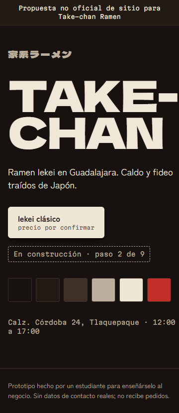

# Progreso · SENSEI (Take-chan Ramen)

Propuesta no oficial de sitio para Take-chan Ramen.

- **Pages:** https://andre-bhp.github.io/SENSEI/
- **Repositorio:** https://github.com/Andre-BHP/SENSEI
- **Última subida:** 2026-11-15 23:40 (hora de Guadalajara)

## Pasos
- [x] 0. Repositorio, Pages "en construcción" (aviso y `noindex`) y este archivo
- [x] 1. Leer fuentes
- [x] 2. `DESIGN.md` con impeccable
- [x] 3. Datos (`negocio.json` y `menu.json`)
- [ ] 4. Inicio
- [ ] 5. Menú y máquina de tickets
- [ ] 6. Sucursales y JSON-LD
- [ ] 7. Pruebas, axe y capturas
- [ ] 8. Entregables
- [ ] 9. Push y Pages final

## Último paso
**Paso 3.** Proyecto Angular 22 con prerender en `sitio/` (configuración copiada de Arleth, con `baseHref /SENSEI/` para Pages). Datos en [`sitio/src/datos/negocio.json`](sitio/src/datos/negocio.json) y [`menu.json`](sitio/src/datos/menu.json): cada dato con `confirmado`. No hay ningún precio: todos quedan en `null` y se verán "por confirmar". Servicios de horario ("abierto ahora" con la hora de Guadalajara) y de contacto en modo demostración. Sin cambio visual todavía.

## Sigue
Paso 4: inicio (héroe con TAKE-CHAN gigante y el tazón con vapor, Iekei, favoritos en bento, primera vez, sucursales y pie).

## Capturas más recientes
| 360 px | 1440 px |
|---|---|
|  |  |
