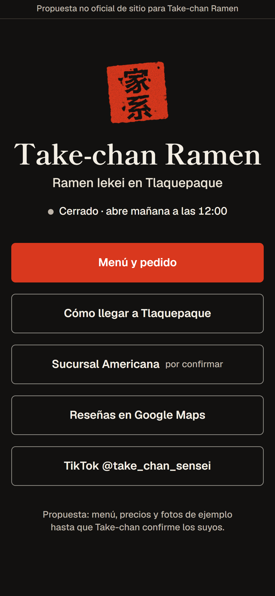
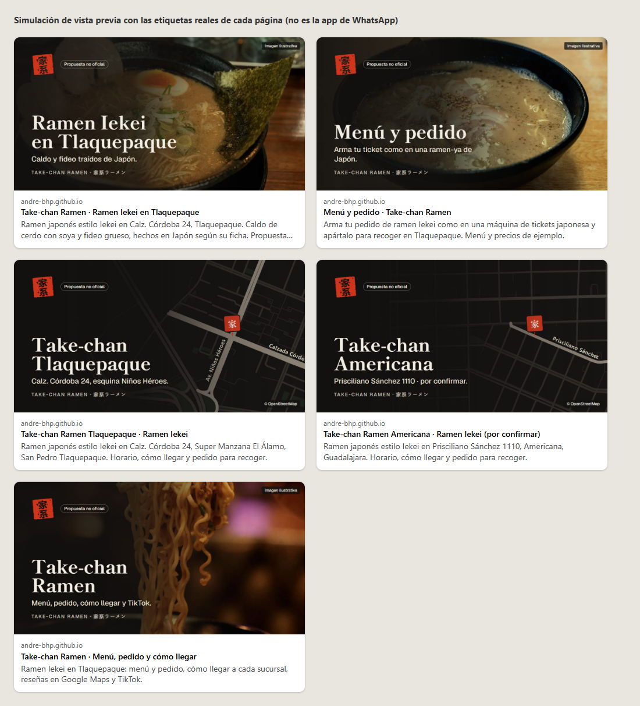

# Progreso · Take-chan Ramen (propuesta no oficial)

- **Pages:** https://andre-bhp.github.io/Take-chan/
- **Repositorio:** https://github.com/Andre-BHP/Take-chan
- **Última subida:** 2026-11-16 21:03 (hora de Guadalajara)

## Rediseño (2026-11-15)
André revisó la primera versión: "quedó muy feo y muy mal". Este rediseño cambia la dirección a "una ramen-ya de Yokohama de noche": fotos de ejemplo rotuladas, negro sumi y papel washi, 家系 vertical y un solo acento bermellón.

- [x] R0. Capturas de "antes"
- [x] R1. `DESIGN.md` nuevo y wireframe gris de inicio y menú
- [x] R2. Fotos de Unsplash (AVIF y WebP en 3 tamaños, blurhash) y créditos
- [x] R3. Tipografías, tokens y portada nueva
- [x] R4. `/menu` con una máquina de tickets de verdad
- [x] R5. Sucursales y pie
- [x] R6. Revisión de impeccable y design-taste-frontend, y correcciones
- [x] R7. Pruebas, comparativa antes y después, mockups de visita
- [x] R8. Reporte

## Nivel 4 (2026-11-16)
Plan de Arthemis: todo lo que no depende del negocio, para publicar el sitio oficial en menos de una hora.

- [x] P0. Interruptor de modo, propuesta u oficial
- [x] P1. Vista previa al compartir y `/links`
- [ ] P2. Datos editables desde CSV, aviso y agotado 売切
- [ ] P3. Preguntas frecuentes y SEO local
- [ ] P4. Versión en inglés
- [ ] P5. PWA y menú sin conexión
- [ ] P6. Impresos con QR
- [ ] P7. Estadísticas preparadas y plantilla de reporte
- [ ] P8. Privacidad, accesibilidad y créditos
- [ ] P9. Calidad final, guías probadas y reporte

## Nivel 3 (2026-11-16)
Plan de Arthemis para pasar de "bien hecho" a "de premio".

- [x] N0. Crítica y diferencias con el plan (`entregables/N0_critica.md`)
- [x] N1. Una sola mirada fotográfica: tratamiento de color, grano y viñeta
- [x] N2. Mapas propios de OpenStreetMap en lugar de fotos de las sucursales
- [x] N3. "Cómo se hace un Iekei": tazón visto desde arriba y pasos 一二三四
- [x] N4. Sello hanko de la propuesta
- [x] N5. Héroe legible y saludo いらっしゃいませ
- [x] N6. Ritmo editorial: títulos, 4.8 con sección propia y pausa a sangre
- [x] N7. Menú que vende: sugerencia, detalle de tecla y vista de lista
- [x] N8. Reloj en vivo, TikTok bajo demanda, contraste AA y detalles
- [x] N9. Guion de fotos para André
- [x] N10. Pruebas, pulido, videos y reporte

## Movimiento (2026-11-16)
André: "mejor animación, más transiciones, mejor diseño, mejor todo". Metáfora: entrar a la ramen-ya apartando la noren. Cada paso con video (MP4) y GIF en `entregables/avances/video/`.

- [x] M0. Tokens de movimiento, Lenis y GSAP (solo en navegador), reduced-motion y grabación de video
- [x] M1. Intro de la noren y transición entre páginas
- [x] M2. Héroe a sangre, titular por líneas, 家系 con trazo y paralaje
- [x] M3. Washi rasgado, "Qué es el Iekei", prueba social y bento con la transición hacia `/menu`
- [x] M4. Medidor del tazón en "Cómo se hace", sucursales y noren final de tela
- [x] M5. `/menu` física: encendido, vuelo al pedido, odómetro, indicadores e impresión y corte del ticket
- [x] M6. Revisiones de impeccable y design-taste-frontend
- [x] M7. Pruebas: axe, 360 px, peso, LCP con intro, CLS 0, 60 fps, reduced-motion
- [x] M8. Videos, GIF, capturas de visita y reporte

## Primera versión (pasos 0 a 9, terminada)
Repositorio, Pages, datos, inicio, máquina de tickets, sucursales con JSON-LD, pruebas y lista para el negocio. Capturas en `entregables/avances/antes/`.

## Último paso
**P1.** Vista previa al compartir: una imagen de 1200 × 630 por página y por modo (`herramientas/og.mjs`), con la foto tratada o el mapa, el sello, el nombre y la frase; las de la propuesta dicen "Propuesta no oficial" y llevan el rótulo de imagen ilustrativa. Cada página lleva og:image absoluta, og:site_name y la tarjeta grande de X. `/links` para la biografía de TikTok: página estática generada en el build desde `negocio.json` (`sitio/scripts/links.mjs`), con el sello, el estado de hoy y botones grandes (Menú y pedido, Cómo llegar, Americana por confirmar, Reseñas y TikTok). Pesa 94 KB (límite 150) y no lleva la intro. `herramientas/compartir.mjs` revisa etiquetas, imágenes, peso y axe en los dos modos: todo en orden. Falta probar el enlace en WhatsApp de verdad desde un celular (André); la captura es una simulación con las etiquetas reales.

## Sigue
P2: menú, horario y aviso editables desde una hoja de Google en CSV (con respaldo en los JSON), banda de aviso y platillo agotado 売切.

## Capturas más recientes
| /links (390) | Vista previa (simulación con las etiquetas reales) |
|---|---|
|  |  |
