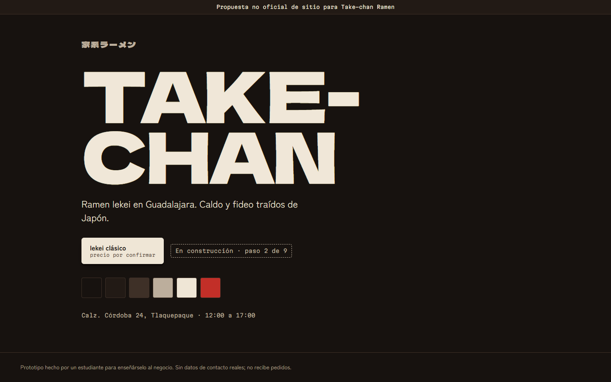

# Progreso · SENSEI (Take-chan Ramen)

Propuesta no oficial de sitio para Take-chan Ramen.

- **Pages:** https://andre-bhp.github.io/SENSEI/
- **Repositorio:** https://github.com/Andre-BHP/SENSEI
- **Última subida:** 2026-11-15 23:25 (hora de Guadalajara)

## Pasos
- [x] 0. Repositorio, Pages "en construcción" (aviso y `noindex`) y este archivo
- [x] 1. Leer fuentes
- [x] 2. `DESIGN.md` con impeccable
- [ ] 3. Datos (`negocio.json` y `menu.json`)
- [ ] 4. Inicio
- [ ] 5. Menú y máquina de tickets
- [ ] 6. Sucursales y JSON-LD
- [ ] 7. Pruebas, axe y capturas
- [ ] 8. Entregables
- [ ] 9. Push y Pages final

## Último paso
**Paso 2.** [`DESIGN.md`](DESIGN.md) con tokens (color, tipografía de 6 niveles, espaciado de 8 px, radios, sombras y tiempos) y la carta que justifica cada decisión. [`PRODUCT.md`](PRODUCT.md) con lo confirmado. Fuentes autohospedadas en subconjunto (unos 47 KB). La página en construcción ya muestra la paleta y la tipografía.

## Sigue
Paso 3: datos (`negocio.json` y `menu.json` con `confirmado` por dato).

## Capturas más recientes
| 360 px | 1440 px |
|---|---|
|  |  |
