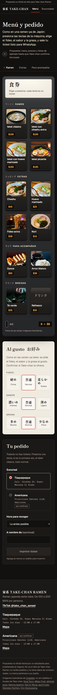
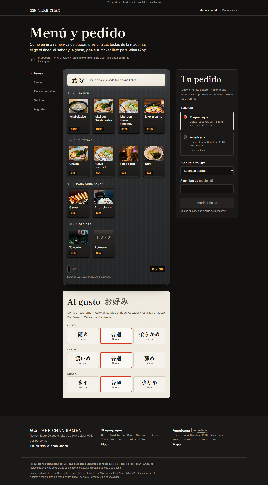
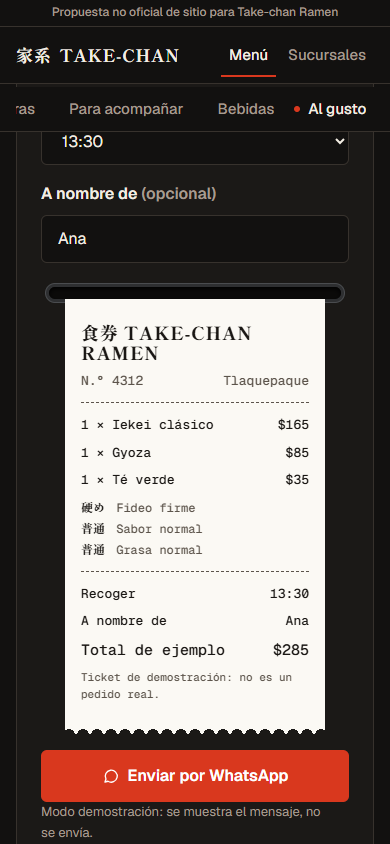

# Progreso · Take-chan Ramen (propuesta no oficial)

- **Pages:** https://andre-bhp.github.io/Take-chan/
- **Repositorio:** https://github.com/Andre-BHP/Take-chan
- **Última subida:** 2026-11-16 10:18 (hora de Guadalajara)

## Rediseño (2026-11-15)
André revisó la primera versión: "quedó muy feo y muy mal". Este rediseño cambia la dirección a "una ramen-ya de Yokohama de noche": fotos de ejemplo rotuladas, negro sumi y papel washi, 家系 vertical y un solo acento bermellón.

- [x] R0. Capturas de "antes"
- [x] R1. `DESIGN.md` nuevo y wireframe gris de inicio y menú
- [x] R2. Fotos de Unsplash (AVIF y WebP en 3 tamaños, blurhash) y créditos
- [x] R3. Tipografías, tokens y portada nueva
- [x] R4. `/menu` con una máquina de tickets de verdad
- [ ] R5. Sucursales y pie
- [ ] R6. Revisión de impeccable y design-taste-frontend, y correcciones
- [ ] R7. Pruebas, comparativa antes y después, mockups de visita
- [ ] R8. Reporte

## Primera versión (pasos 0 a 9, terminada)
Repositorio, Pages, datos, inicio, máquina de tickets, sucursales con JSON-LD, pruebas y lista para el negocio. Capturas en `entregables/avances/antes/`.

## Último paso
**R4.** `/menu` con una máquina de tickets de verdad: marco de metal, letrero iluminado 食券, teclas con foto, nombre y precio en LED ámbar, contador bermellón, ranura de monedas y pantalla con el total. La tecla se hunde al presionarla. Hoja "al gusto" en washi con kanji grande y traducción (硬め, 普通, 柔らかめ…). Panel con sucursal, hora y nombre; "Imprimir ticket" saca un ticket térmico de la ranura (el único momento animado de la página) y "Enviar por WhatsApp" muestra el mensaje en modo demostración. Menú de ejemplo completo, sin teclas "Por definir"; una sola nota. axe sin violaciones.

## Sigue
R5: sucursales y pie.

## Capturas más recientes
| Menú 360 | Menú 1440 | Ticket 390 |
|---|---|---|
|  |  |  |
