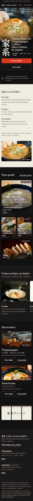
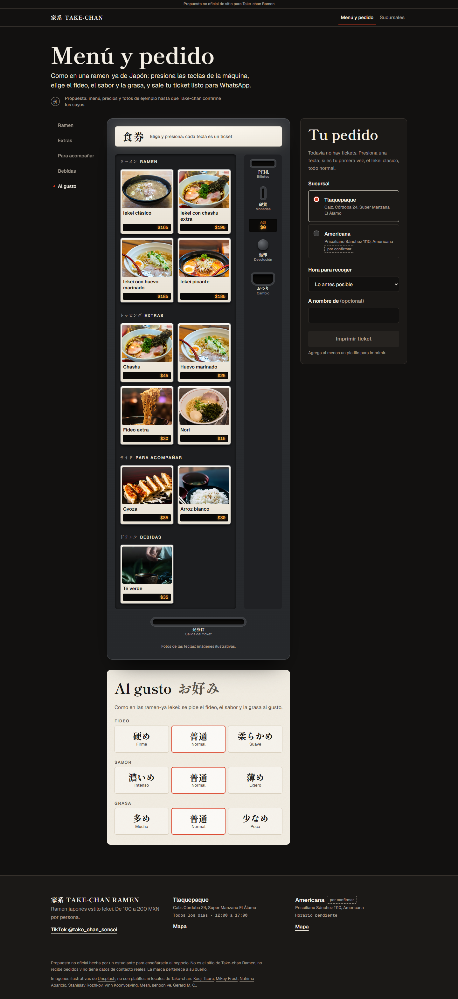
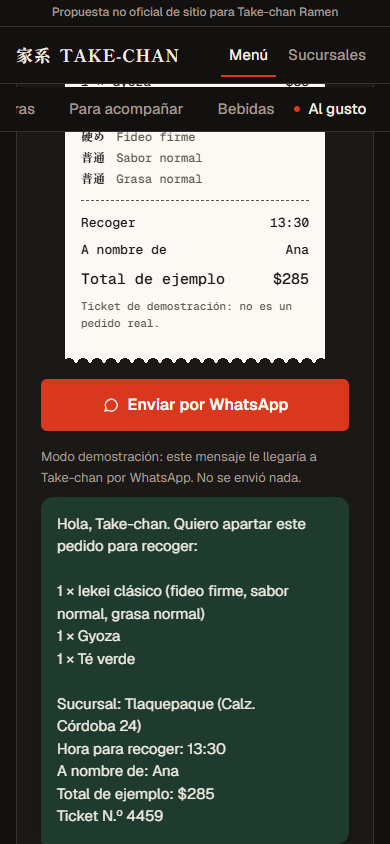

# Progreso · Take-chan Ramen (propuesta no oficial)

- **Pages:** https://andre-bhp.github.io/Take-chan/
- **Repositorio:** https://github.com/Andre-BHP/Take-chan
- **Última subida:** 2026-11-16 10:38 (hora de Guadalajara)

## Rediseño (2026-11-15)
André revisó la primera versión: "quedó muy feo y muy mal". Este rediseño cambia la dirección a "una ramen-ya de Yokohama de noche": fotos de ejemplo rotuladas, negro sumi y papel washi, 家系 vertical y un solo acento bermellón.

- [x] R0. Capturas de "antes"
- [x] R1. `DESIGN.md` nuevo y wireframe gris de inicio y menú
- [x] R2. Fotos de Unsplash (AVIF y WebP en 3 tamaños, blurhash) y créditos
- [x] R3. Tipografías, tokens y portada nueva
- [x] R4. `/menu` con una máquina de tickets de verdad
- [x] R5. Sucursales y pie
- [x] R6. Revisión de impeccable y design-taste-frontend, y correcciones
- [ ] R7. Pruebas, comparativa antes y después, mockups de visita
- [ ] R8. Reporte

## Primera versión (pasos 0 a 9, terminada)
Repositorio, Pages, datos, inicio, máquina de tickets, sucursales con JSON-LD, pruebas y lista para el negocio. Capturas en `entregables/avances/antes/`.

## Último paso
**R6.** Revisiones de impeccable (finish review), design-taste-frontend y better-typography, y correcciones: máquina reconstruida (teclas iluminadas tipo 券売機, columna de cobro con billetes, monedas, total, devolución y cambio, y boca de salida del ticket); mensaje de WhatsApp demo en línea, sin ventana modal; noren de tela washi con 家系ラーメン en sumi, al cierre de la página; sin rótulo encima del título y 家系 más grande en celular; fotos de proceso nuevas para no repetir imágenes; la Americana ya no muestra horario ni "abierto/cerrado" supuestos; direcciones en sans; enlaces de 44 px; sin desborde a 320 px; Geist en negritas a 600 sin sintetizar; subconjunto japonés automático. Se mantuvieron, porque el plan los pide: la sección horizontal fija y el vaivén del noren.

## Sigue
R7: pruebas, comparativa antes y después y mockups de visita.

## Capturas más recientes
| Portada 360 | Menú 1440 | WhatsApp demo 390 |
|---|---|---|
|  |  |  |
