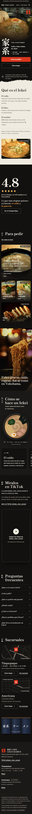
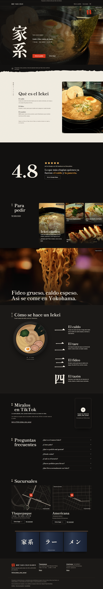

# Progreso · Take-chan Ramen (propuesta no oficial)

- **Pages:** https://andre-bhp.github.io/Take-chan/
- **Repositorio:** https://github.com/Andre-BHP/Take-chan
- **Última subida:** 2026-11-16 22:05 (hora de Guadalajara)

## Rediseño (2026-11-15)
André revisó la primera versión: "quedó muy feo y muy mal". Este rediseño cambia la dirección a "una ramen-ya de Yokohama de noche": fotos de ejemplo rotuladas, negro sumi y papel washi, 家系 vertical y un solo acento bermellón.

- [x] R0. Capturas de "antes"
- [x] R1. `DESIGN.md` nuevo y wireframe gris de inicio y menú
- [x] R2. Fotos de Unsplash (AVIF y WebP en 3 tamaños, blurhash) y créditos
- [x] R3. Tipografías, tokens y portada nueva
- [x] R4. `/menu` con una máquina de tickets de verdad
- [x] R5. Sucursales y pie
- [x] R6. Revisión de impeccable y design-taste-frontend, y correcciones
- [x] R7. Pruebas, comparativa antes y después, mockups de visita
- [x] R8. Reporte

## Nivel 4 (2026-11-16)
Plan de Arthemis: todo lo que no depende del negocio, para publicar el sitio oficial en menos de una hora.

- [x] P0. Interruptor de modo, propuesta u oficial
- [x] P1. Vista previa al compartir y `/links`
- [x] P2. Datos editables desde CSV, aviso y agotado 売切
- [x] P3. Preguntas frecuentes y SEO local
- [x] P4. Versión en inglés
- [x] P5. PWA y menú sin conexión
- [x] P6. Impresos con QR
- [x] P7. Estadísticas preparadas y plantilla de reporte
- [x] P8. Privacidad, accesibilidad y créditos
- [x] P9. Calidad final, guías probadas y reporte

## Nivel 3 (2026-11-16)
Plan de Arthemis para pasar de "bien hecho" a "de premio".

- [x] N0. Crítica y diferencias con el plan (`entregables/N0_critica.md`)
- [x] N1. Una sola mirada fotográfica: tratamiento de color, grano y viñeta
- [x] N2. Mapas propios de OpenStreetMap en lugar de fotos de las sucursales
- [x] N3. "Cómo se hace un Iekei": tazón visto desde arriba y pasos 一二三四
- [x] N4. Sello hanko de la propuesta
- [x] N5. Héroe legible y saludo いらっしゃいませ
- [x] N6. Ritmo editorial: títulos, 4.8 con sección propia y pausa a sangre
- [x] N7. Menú que vende: sugerencia, detalle de tecla y vista de lista
- [x] N8. Reloj en vivo, TikTok bajo demanda, contraste AA y detalles
- [x] N9. Guion de fotos para André
- [x] N10. Pruebas, pulido, videos y reporte

## Movimiento (2026-11-16)
André: "mejor animación, más transiciones, mejor diseño, mejor todo". Metáfora: entrar a la ramen-ya apartando la noren. Cada paso con video (MP4) y GIF en `entregables/avances/video/`.

- [x] M0. Tokens de movimiento, Lenis y GSAP (solo en navegador), reduced-motion y grabación de video
- [x] M1. Intro de la noren y transición entre páginas
- [x] M2. Héroe a sangre, titular por líneas, 家系 con trazo y paralaje
- [x] M3. Washi rasgado, "Qué es el Iekei", prueba social y bento con la transición hacia `/menu`
- [x] M4. Medidor del tazón en "Cómo se hace", sucursales y noren final de tela
- [x] M5. `/menu` física: encendido, vuelo al pedido, odómetro, indicadores e impresión y corte del ticket
- [x] M6. Revisiones de impeccable y design-taste-frontend
- [x] M7. Pruebas: axe, 360 px, peso, LCP con intro, CLS 0, 60 fps, reduced-motion
- [x] M8. Videos, GIF, capturas de visita y reporte

## Primera versión (pasos 0 a 9, terminada)
Repositorio, Pages, datos, inicio, máquina de tickets, sucursales con JSON-LD, pruebas y lista para el negocio. Capturas en `entregables/avances/antes/`.

## Último paso
**P9.** Cierre del nivel 4. Lighthouse sobre el ensayo oficial: accesibilidad, buenas prácticas y SEO en 100 en todas las páginas, y rendimiento en escritorio de 99 a 100. En celular, el rendimiento queda entre 77 y 83 (no llega a 95): Lighthouse simula 4G lenta y cuenta como críticas las 6 fuentes y el JS de Angular. Medido de verdad, el LCP es de 0.9 a 2.3 s y el CLS de 0.0014 como máximo; subirlo exige quitar pesos de fuente o retrasar GSAP y la intro, que es decisión de André. La propuesta da SEO 63 por el noindex, a propósito. Se corrigió un aria-label prohibido de SplitText y la foto del héroe pide 960 px en celular. `herramientas/recorridos.mjs` corre las 15 pruebas (los seis recorridos del plan más axe en 11 rutas, 360 px, peso, LCP, CLS, fps, compartir, SEO local, PWA, estadísticas y traducciones): todas en orden (`entregables/pruebas-nivel4.txt`). `GUIA_PUBLICAR.md` probada de punta a punta con el ensayo oficial sin publicar; el build oficial vacío se detiene pidiendo el dominio. Reporte en `entregables/REPORTE_NIVEL_4.md`.

## Sigue
Nivel 4 terminado. Falta lo que depende del negocio o de cuentas (WhatsApp, dominio, hoja, GoatCounter, datos legales y fotos reales) y probar en un celular físico el enlace por WhatsApp y la instalación.

## Capturas más recientes
| Portada 360 | Portada 1440 | Lighthouse |
|---|---|---|
|  |  | [resumen](entregables/lighthouse/oficial-resumen.md) |
