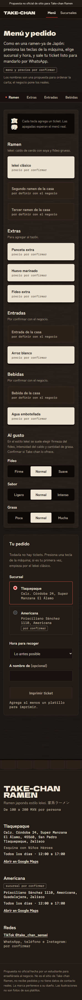
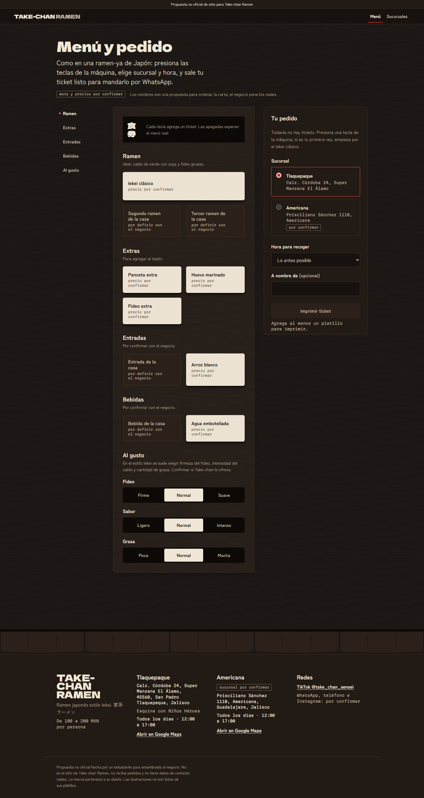
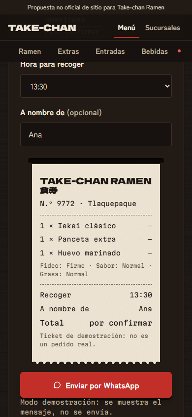

# Progreso · SENSEI (Take-chan Ramen)

Propuesta no oficial de sitio para Take-chan Ramen.

- **Pages:** https://andre-bhp.github.io/SENSEI/
- **Repositorio:** https://github.com/Andre-BHP/SENSEI
- **Última subida:** 2026-11-16 00:45 (hora de Guadalajara)

## Pasos
- [x] 0. Repositorio, Pages "en construcción" (aviso y `noindex`) y este archivo
- [x] 1. Leer fuentes
- [x] 2. `DESIGN.md` con impeccable
- [x] 3. Datos (`negocio.json` y `menu.json`)
- [x] 4. Inicio
- [x] 5. Menú y máquina de tickets
- [ ] 6. Sucursales y JSON-LD
- [ ] 7. Pruebas, axe y capturas
- [ ] 8. Entregables
- [ ] 9. Push y Pages final

## Último paso
**Paso 5.** `/menu` con la máquina de tickets (食券): teclas de washi que se hunden, contador en rojo laca, teclas apagadas para los platillos que faltan, "al gusto" del Iekei (fideo, sabor, grasa), índice que sigue el scroll, sucursal, hora para recoger y nombre. "Imprimir ticket" saca el ticket de la ranura y "Enviar por WhatsApp" muestra el mensaje en modo demostración. Total: "por confirmar".

## Sigue
Paso 6: páginas `/tlaquepaque` y `/americana` con JSON-LD `Restaurant`.

## Capturas más recientes
| Menú 360 px | Menú 1440 px | Ticket 390 px |
|---|---|---|
|  |  |  |
