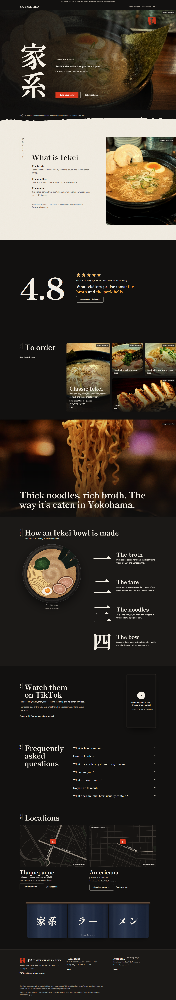
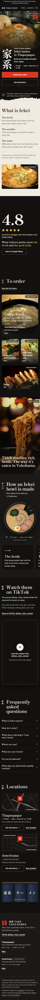

# Progreso · Take-chan Ramen (propuesta no oficial)

- **Pages:** https://andre-bhp.github.io/Take-chan/
- **Repositorio:** https://github.com/Andre-BHP/Take-chan
- **Última subida:** 2026-11-16 21:26 (hora de Guadalajara)

## Rediseño (2026-11-15)
André revisó la primera versión: "quedó muy feo y muy mal". Este rediseño cambia la dirección a "una ramen-ya de Yokohama de noche": fotos de ejemplo rotuladas, negro sumi y papel washi, 家系 vertical y un solo acento bermellón.

- [x] R0. Capturas de "antes"
- [x] R1. `DESIGN.md` nuevo y wireframe gris de inicio y menú
- [x] R2. Fotos de Unsplash (AVIF y WebP en 3 tamaños, blurhash) y créditos
- [x] R3. Tipografías, tokens y portada nueva
- [x] R4. `/menu` con una máquina de tickets de verdad
- [x] R5. Sucursales y pie
- [x] R6. Revisión de impeccable y design-taste-frontend, y correcciones
- [x] R7. Pruebas, comparativa antes y después, mockups de visita
- [x] R8. Reporte

## Nivel 4 (2026-11-16)
Plan de Arthemis: todo lo que no depende del negocio, para publicar el sitio oficial en menos de una hora.

- [x] P0. Interruptor de modo, propuesta u oficial
- [x] P1. Vista previa al compartir y `/links`
- [x] P2. Datos editables desde CSV, aviso y agotado 売切
- [x] P3. Preguntas frecuentes y SEO local
- [x] P4. Versión en inglés
- [ ] P5. PWA y menú sin conexión
- [ ] P6. Impresos con QR
- [ ] P7. Estadísticas preparadas y plantilla de reporte
- [ ] P8. Privacidad, accesibilidad y créditos
- [ ] P9. Calidad final, guías probadas y reporte

## Nivel 3 (2026-11-16)
Plan de Arthemis para pasar de "bien hecho" a "de premio".

- [x] N0. Crítica y diferencias con el plan (`entregables/N0_critica.md`)
- [x] N1. Una sola mirada fotográfica: tratamiento de color, grano y viñeta
- [x] N2. Mapas propios de OpenStreetMap en lugar de fotos de las sucursales
- [x] N3. "Cómo se hace un Iekei": tazón visto desde arriba y pasos 一二三四
- [x] N4. Sello hanko de la propuesta
- [x] N5. Héroe legible y saludo いらっしゃいませ
- [x] N6. Ritmo editorial: títulos, 4.8 con sección propia y pausa a sangre
- [x] N7. Menú que vende: sugerencia, detalle de tecla y vista de lista
- [x] N8. Reloj en vivo, TikTok bajo demanda, contraste AA y detalles
- [x] N9. Guion de fotos para André
- [x] N10. Pruebas, pulido, videos y reporte

## Movimiento (2026-11-16)
André: "mejor animación, más transiciones, mejor diseño, mejor todo". Metáfora: entrar a la ramen-ya apartando la noren. Cada paso con video (MP4) y GIF en `entregables/avances/video/`.

- [x] M0. Tokens de movimiento, Lenis y GSAP (solo en navegador), reduced-motion y grabación de video
- [x] M1. Intro de la noren y transición entre páginas
- [x] M2. Héroe a sangre, titular por líneas, 家系 con trazo y paralaje
- [x] M3. Washi rasgado, "Qué es el Iekei", prueba social y bento con la transición hacia `/menu`
- [x] M4. Medidor del tazón en "Cómo se hace", sucursales y noren final de tela
- [x] M5. `/menu` física: encendido, vuelo al pedido, odómetro, indicadores e impresión y corte del ticket
- [x] M6. Revisiones de impeccable y design-taste-frontend
- [x] M7. Pruebas: axe, 360 px, peso, LCP con intro, CLS 0, 60 fps, reduced-motion
- [x] M8. Videos, GIF, capturas de visita y reporte

## Primera versión (pasos 0 a 9, terminada)
Repositorio, Pages, datos, inicio, máquina de tickets, sucursales con JSON-LD, pruebas y lista para el negocio. Capturas en `entregables/avances/antes/`.

## Último paso
**P4.** Versión en inglés: `/en`, `/en/menu`, `/en/tlaquepaque` y `/en/americana`, prerenderizadas, con el selector ES · EN en el encabezado (lleva a la misma página en el otro idioma sin recargar), `lang`, `og:locale` y `hreflang` (es-MX, en y x-default). Los textos se escriben en español y pasan por `t()`. El diccionario (`sitio/src/app/i18n/en.ts`, 211 textos con traducción natural: "Build your order", "Ticket machine", "First time? Get the classic") solo se descarga en `/en`, así que la portada en español no crece. El japonés queda igual; el mensaje de WhatsApp va en español para el local, y así se le avisa al turista. El aviso de propuesta es bilingüe. `herramientas/llaves-idioma.mjs` lista los textos sin traducir (0) y `herramientas/idiomas.mjs` prueba el selector, la navegación dentro de `/en` y que no quede español suelto: todo en orden. La cabecera se compactó para no desbordar a 360 con el selector. axe limpio en las 8 rutas; portada de 483 KB.

## Sigue
P5: PWA (manifest e íconos del sello) y el menú sin conexión con el service worker de Angular.

## Capturas más recientes
| /en (1440) | /en (360) | /en/menu (360) |
|---|---|---|
|  |  |  |
