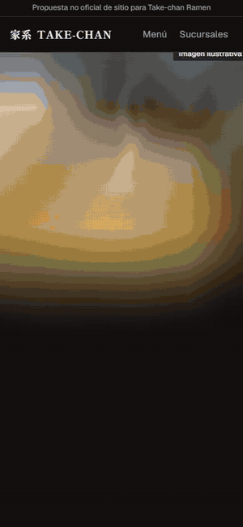

# Progreso · Take-chan Ramen (propuesta no oficial)

- **Pages:** https://andre-bhp.github.io/Take-chan/
- **Repositorio:** https://github.com/Andre-BHP/Take-chan
- **Última subida:** 2026-11-16 15:30 (hora de Guadalajara)

## Rediseño (2026-11-15)
André revisó la primera versión: "quedó muy feo y muy mal". Este rediseño cambia la dirección a "una ramen-ya de Yokohama de noche": fotos de ejemplo rotuladas, negro sumi y papel washi, 家系 vertical y un solo acento bermellón.

- [x] R0. Capturas de "antes"
- [x] R1. `DESIGN.md` nuevo y wireframe gris de inicio y menú
- [x] R2. Fotos de Unsplash (AVIF y WebP en 3 tamaños, blurhash) y créditos
- [x] R3. Tipografías, tokens y portada nueva
- [x] R4. `/menu` con una máquina de tickets de verdad
- [x] R5. Sucursales y pie
- [x] R6. Revisión de impeccable y design-taste-frontend, y correcciones
- [x] R7. Pruebas, comparativa antes y después, mockups de visita
- [x] R8. Reporte

## Movimiento (2026-11-16)
André: "mejor animación, más transiciones, mejor diseño, mejor todo". Metáfora: entrar a la ramen-ya apartando la noren. Cada paso con video (MP4) y GIF en `entregables/avances/video/`.

- [x] M0. Tokens de movimiento, Lenis y GSAP (solo en navegador), reduced-motion y grabación de video
- [x] M1. Intro de la noren y transición entre páginas
- [x] M2. Héroe a sangre, titular por líneas, 家系 con trazo y paralaje
- [x] M3. Washi rasgado, "Qué es el Iekei", prueba social y bento con la transición hacia `/menu`
- [x] M4. Medidor del tazón en "Cómo se hace", sucursales y noren final de tela
- [x] M5. `/menu` física: encendido, vuelo al pedido, odómetro, indicadores e impresión y corte del ticket
- [x] M6. Revisiones de impeccable y design-taste-frontend
- [ ] M7. Pruebas: axe, 360 px, peso, LCP con intro, CLS 0, 60 fps, reduced-motion
- [ ] M8. Videos, GIF, capturas de visita y reporte

## Primera versión (pasos 0 a 9, terminada)
Repositorio, Pages, datos, inicio, máquina de tickets, sucursales con JSON-LD, pruebas y lista para el negocio. Capturas en `entregables/avances/antes/`.

## Último paso
**M6.** Revisiones de impeccable y design-taste-frontend, con videos a 10 fps. Arreglos: la transición entre páginas ahora es un telón de noren de tela de verdad (tres paños índigo bajan escalonados, la página cambia debajo y se separan hacia los lados); solo vuela la foto del platillo tocado y solo en escritorio, con la ruta del menú precargada; la cifra de Google rueda de 4.0 a 4.8 (nunca desde 0) y se lee completa con lector de pantalla; el medidor avanza con el scroll vertical en celular; la luz de 発券口 está en la ranura de donde sale el papel; el 家系 de la intro se dibuja completo y se desvanece antes de abrir los paños; el botón "Saltar" desaparece al terminar; el vapor ya no fuerza recálculos en cada cuadro y se pausa fuera de vista; el latido de "abierto" late 3 veces; los enlaces con ancla y el botón Atrás respetan la posición; la noren final pone dos caracteres por paño. Medido: CLS 0, scroll a 59 fps sin tareas largas.

## Sigue
M7: pruebas completas.

## Capturas más recientes
| Telón entre páginas, 1440 px | Medidor en celular |
|---|---|
|  |  |

Videos: [transición 1440](entregables/avances/video/2026-11-16_M6_transicion_1440.mp4) · [transición 390](entregables/avances/video/2026-11-16_M6_transicion_390.mp4) · [intro 390](entregables/avances/video/2026-11-16_M6_intro_390.mp4) · [menú 390](entregables/avances/video/2026-11-16_M6_menu_390.mp4)
