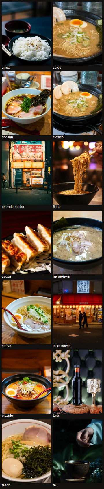
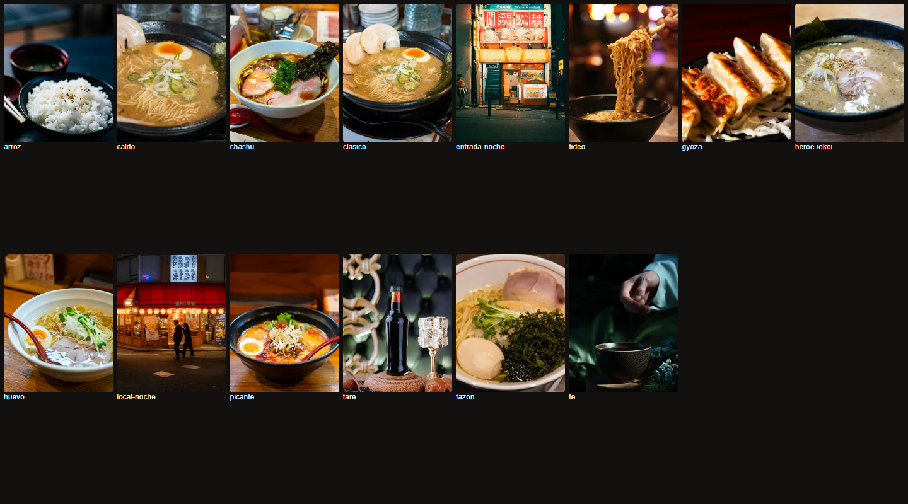

# Progreso · Take-chan Ramen (propuesta no oficial)

- **Pages:** https://andre-bhp.github.io/Take-chan/
- **Repositorio:** https://github.com/Andre-BHP/Take-chan
- **Última subida:** 2026-11-15 23:49 (hora de Guadalajara)

## Rediseño (2026-11-15)
André revisó la primera versión: "quedó muy feo y muy mal". Este rediseño cambia la dirección a "una ramen-ya de Yokohama de noche": fotos de ejemplo rotuladas, negro sumi y papel washi, 家系 vertical y un solo acento bermellón.

- [x] R0. Capturas de "antes"
- [x] R1. `DESIGN.md` nuevo y wireframe gris de inicio y menú
- [x] R2. Fotos de Unsplash (AVIF y WebP en 3 tamaños, blurhash) y créditos
- [ ] R3. Tipografías, tokens y portada nueva
- [ ] R4. `/menu` con una máquina de tickets de verdad
- [ ] R5. Sucursales y pie
- [ ] R6. Revisión de impeccable y design-taste-frontend, y correcciones
- [ ] R7. Pruebas, comparativa antes y después, mockups de visita
- [ ] R8. Reporte

## Primera versión (pasos 0 a 9, terminada)
Repositorio, Pages, datos, inicio, máquina de tickets, sucursales con JSON-LD, pruebas y lista para el negocio. Capturas en `entregables/avances/antes/`.

## Último paso
**R2.** 14 fotos de Unsplash (sobre todo de Kouji Tsuru, fotógrafo de ramen en Japón) para héroe, bento, "cómo se hace", sucursales y máquina. AVIF y WebP a 480, 960 y 1600 px con color promedio y miniatura borrosa para la carga (`herramientas/procesar-fotos.mjs`). Créditos en [`entregables/fotos-creditos.md`](entregables/fotos-creditos.md). Todas irán rotuladas "Imagen ilustrativa".

## Sigue
R3: tipografías, tokens y portada nueva.

## Capturas más recientes
| Fotos 360 | Fotos 1440 |
|---|---|
|  |  |
