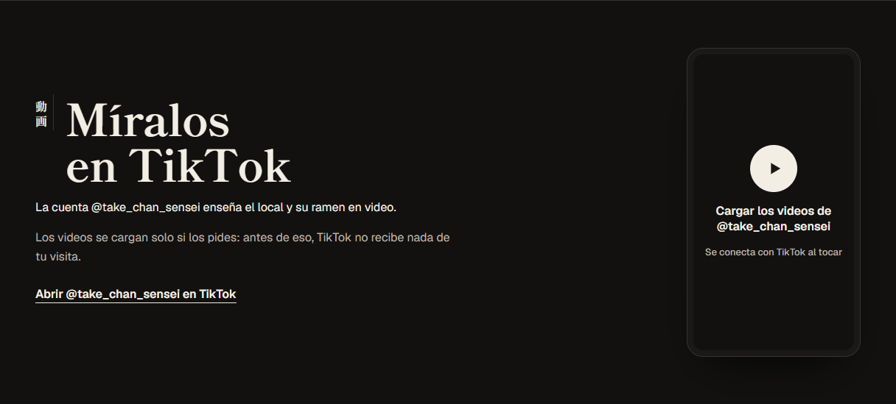
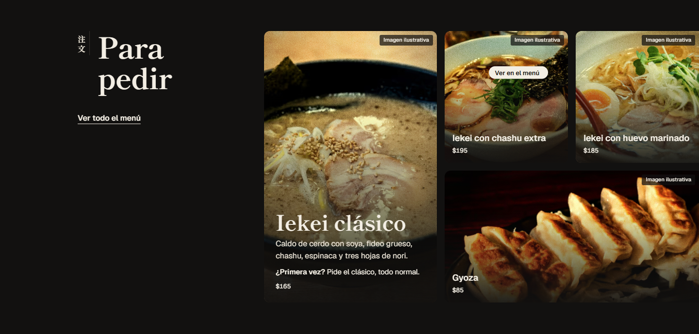
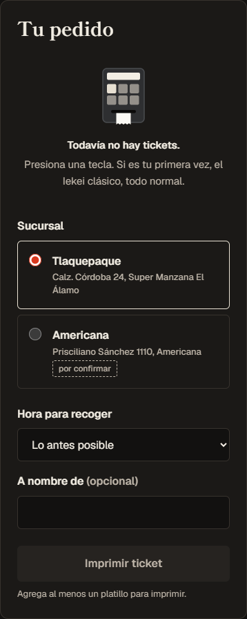
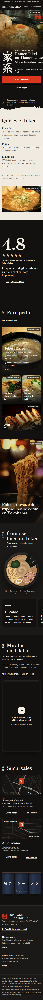
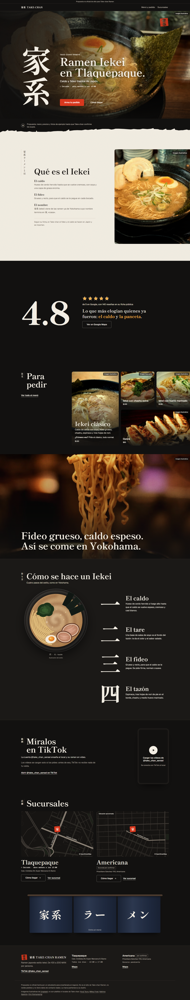

# Progreso · Take-chan Ramen (propuesta no oficial)

- **Pages:** https://andre-bhp.github.io/Take-chan/
- **Repositorio:** https://github.com/Andre-BHP/Take-chan
- **Última subida:** 2026-11-16 20:27 (hora de Guadalajara)

## Rediseño (2026-11-15)
André revisó la primera versión: "quedó muy feo y muy mal". Este rediseño cambia la dirección a "una ramen-ya de Yokohama de noche": fotos de ejemplo rotuladas, negro sumi y papel washi, 家系 vertical y un solo acento bermellón.

- [x] R0. Capturas de "antes"
- [x] R1. `DESIGN.md` nuevo y wireframe gris de inicio y menú
- [x] R2. Fotos de Unsplash (AVIF y WebP en 3 tamaños, blurhash) y créditos
- [x] R3. Tipografías, tokens y portada nueva
- [x] R4. `/menu` con una máquina de tickets de verdad
- [x] R5. Sucursales y pie
- [x] R6. Revisión de impeccable y design-taste-frontend, y correcciones
- [x] R7. Pruebas, comparativa antes y después, mockups de visita
- [x] R8. Reporte

## Nivel 3 (2026-11-16)
Plan de Arthemis para pasar de "bien hecho" a "de premio".

- [x] N0. Crítica y diferencias con el plan (`entregables/N0_critica.md`)
- [x] N1. Una sola mirada fotográfica: tratamiento de color, grano y viñeta
- [x] N2. Mapas propios de OpenStreetMap en lugar de fotos de las sucursales
- [x] N3. "Cómo se hace un Iekei": tazón visto desde arriba y pasos 一二三四
- [x] N4. Sello hanko de la propuesta
- [x] N5. Héroe legible y saludo いらっしゃいませ
- [x] N6. Ritmo editorial: títulos, 4.8 con sección propia y pausa a sangre
- [x] N7. Menú que vende: sugerencia, detalle de tecla y vista de lista
- [x] N8. Reloj en vivo, TikTok bajo demanda, contraste AA y detalles
- [ ] N9. Guion de fotos para André
- [ ] N10. Pruebas, pulido, videos y reporte

## Movimiento (2026-11-16)
André: "mejor animación, más transiciones, mejor diseño, mejor todo". Metáfora: entrar a la ramen-ya apartando la noren. Cada paso con video (MP4) y GIF en `entregables/avances/video/`.

- [x] M0. Tokens de movimiento, Lenis y GSAP (solo en navegador), reduced-motion y grabación de video
- [x] M1. Intro de la noren y transición entre páginas
- [x] M2. Héroe a sangre, titular por líneas, 家系 con trazo y paralaje
- [x] M3. Washi rasgado, "Qué es el Iekei", prueba social y bento con la transición hacia `/menu`
- [x] M4. Medidor del tazón en "Cómo se hace", sucursales y noren final de tela
- [x] M5. `/menu` física: encendido, vuelo al pedido, odómetro, indicadores e impresión y corte del ticket
- [x] M6. Revisiones de impeccable y design-taste-frontend
- [x] M7. Pruebas: axe, 360 px, peso, LCP con intro, CLS 0, 60 fps, reduced-motion
- [x] M8. Videos, GIF, capturas de visita y reporte

## Primera versión (pasos 0 a 9, terminada)
Repositorio, Pages, datos, inicio, máquina de tickets, sucursales con JSON-LD, pruebas y lista para el negocio. Capturas en `entregables/avances/antes/`.

## Último paso
**N8.** Detalles. Reloj vivo: "Abierto ahora · cierra en 2 h 13 min", que cambia justo al empezar cada minuto; cerrado: "Cerrado · abre mañana a las 12:00". TikTok con fachada: "Míralos en TikTok" no pide nada a TikTok hasta que se toca, y entonces carga el embed oficial de @take_chan_sensei, sin el título no verificado. En escritorio, una etiqueta "Ver en el menú" sigue al puntero dentro de cada tarjeta del bento. El gris secundario sube a #bdb4a8 (AA de sobra). Los rótulos "Imagen ilustrativa" van siempre arriba a la derecha (abajo están los textos). El pedido vacío tiene una mini máquina dibujada. La ficha de Tlaquepaque junta los 7 días iguales en "Todos los días". Revisión nueva `herramientas/detalles.mjs` (reloj con hora fija, cero pedidos a TikTok antes del clic): todo en orden. axe limpio, portada de 472 KB, LCP de 1.2 s y CLS de 0.003.

## Sigue
N9: GUION_FOTOS.md con las 12 tomas y PEDIR_AL_NEGOCIO.md al día.

## Capturas más recientes
| TikTok | Bento con etiqueta | Pedido vacío | 360 | 1440 |
|---|---|---|---|---|
|  |  |  |  |  |
