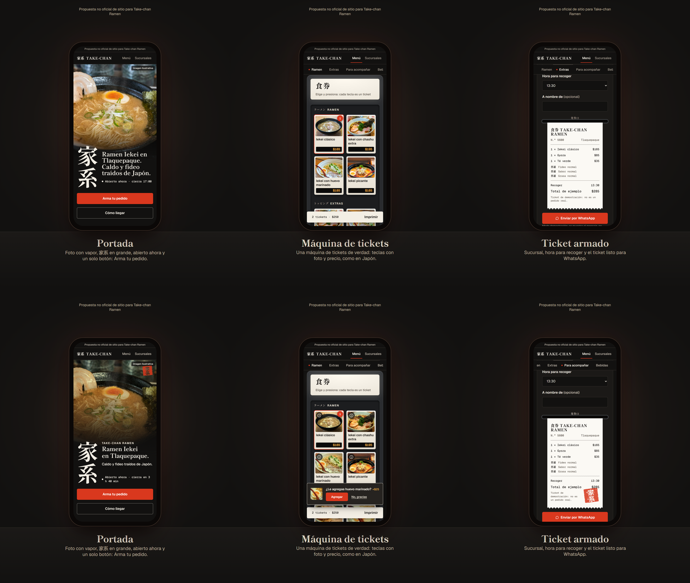

# Reporte del nivel 3 · Take-chan Ramen

Propuesta no oficial. Sitio: https://andre-bhp.github.io/Take-chan/ · Plan: `PLAN_NIVEL_3.md` (N0 a N10).

## Antes y después

## Qué cambió
| Paso | Qué se hizo |
|---|---|
| N0 | Crítica de impeccable. Coincidió en lo grave (la Catedral, el tazón de clip-art, fotos sin mirada común) y discrepó en los antetítulos, el velo del héroe y la cantidad de movimiento. Detalle en `N0_critica.md`. |
| N1 | Un solo tratamiento de color para todas las fotos (`gradear.mjs`), con viñeta y grano encima. Los tazones blancos se recortaron. Fuera la Catedral, el té y la barra. |
| N2 | Mapas propios de OpenStreetMap. Tlaquepaque marca la esquina real de Córdoba y Niños Héroes; la Americana va como "Ubicación aproximada". |
| N3 | "Cómo se hace un Iekei": tazón visto desde arriba que se arma por capas (caldo, tare, fideo y toppings) y pasos con 一二三四 de 160 px. |
| N4 | Sello hanko 家系 en el favicon, el héroe, el pie y estampado en el ticket. |
| N5 | Héroe legible ("Ramen Iekei / en Tlaquepaque.", hasta 88 px), "Take-chan Ramen" chico encima y いらっしゃいませ en la intro. El LCP bajó al quitar las precargas de fuentes. |
| N6 | Títulos grandes con kanji vertical al lado, sección propia del 4.8, bento a sangre, pausa a sangre con los fideos y borde de washi irregular. |
| N7 | Sugerencia "¿Le agregas huevo marinado?", detalle de tecla (botón "i" o mantener presionado), vista máquina o lista y recortes propios para los extras. |
| N8 | Reloj vivo ("cierra en 2 h 13 min"), TikTok que solo carga al tocar, etiqueta "Ver en el menú" en el bento, más contraste, rótulos en la misma esquina, pedido vacío dibujado y horario en una fila. |
| N9 | `GUION_FOTOS.md` (12 tomas) y `PEDIR_AL_NEGOCIO.md` al día. |
| N10 | Pruebas, revisión de terminado, correcciones, videos, capturas de visita y este reporte. |

## Correcciones de la revisión final (N10)
- **El titular se salía del héroe en celular:** el tamaño para celular perdía contra la regla base y "en Tlaquepaque." se cortaba entre 2 y 44 px según el ancho. Ahora cabe en una línea de 320 a 899 px.
- **Rasgos cortados:** las máscaras de las líneas que se revelan cortaban los descendentes (p, q) y los acentos (é, ó, í) del héroe y de los títulos de sección. Ahora tienen aire arriba y abajo.
- **Velo de escritorio:** más fuerte donde el titular, ya más ancho, cae sobre el caldo claro.
- **Pasos inactivos al 50 %:** con el 35 % del plan, el texto no llegaba a AA.
- **Sugerencia sobre el ticket:** en celular la tarjeta flotante tapaba el ticket y el sello. Ahora se oculta cuando el pedido está a la vista y desaparece al imprimir.
- **Gyoza del bento:** pedía una foto de un cuarto de ancho para un espacio de la mitad.
- **Fuentes de respaldo con métricas medidas:** el CLS bajó de 0.015 a 0.0004.

## Videos
- Portada completa: [MP4 1440](avances/video/2026-11-16_N10_inicio_1440.mp4) · [GIF 390](avances/video/2026-11-16_N10_inicio_390.gif)
- Menú y ticket con sello: [MP4 1440](avances/video/2026-11-16_N10_menu_1440.mp4) · [GIF 390](avances/video/2026-11-16_N10_menu_390.gif)
- Por paso: `avances/video/2026-11-16_N2_sucursales_*`, `N3_medidor_*`, `N4_menu_*`, `N5_intro_*`, `N6_ritmo_*`, `N7_vende_*`

## Calidad (medida, registro completo en `pruebas-nivel3.txt`)
| Prueba | Resultado |
|---|---|
| axe (inicio, menú, Tlaquepaque y Americana a 390 y 1440; sugerencia, detalle y lista del menú) | Sin violaciones |
| Scroll horizontal a 360 | Ninguno |
| Peso de la portada (390 px, DPR 3) | 472 KB (límite 500) |
| LCP (4G lenta, CPU 4x) | De 0.8 a 2.3 s según la corrida (límite 2.5) |
| CLS (320, 390, 768, 1440) | 0.0001 a 0.0013 |
| Fluidez al hacer scroll | 59 a 60 fps |
| Movimiento reducido | Todo quieto y visible |
| Reloj, TikTok sin pedidos antes del clic, horario agrupado, estado vacío | En orden (`detalles.mjs`) |

## Decisiones y lo que quedó fuera
- **El kanji va vertical al lado del título, no encima:** la crítica de N0 desaconsejó los antetítulos.
- **Opción B (ilustración sumi-e) no se hizo:** gasta créditos y necesita el visto bueno de André. La crítica la prefiere sobre el tazón en SVG, así que queda propuesta.
- **Fuera de este nivel:** 3D, partículas, cursor global y más transiciones de página. La etiqueta del bento vive solo dentro de sus tarjetas.
- **Lo que no se aplicó de la skill design-taste-frontend:** sus reglas de "sin rótulo en las fotos", "sin número de calle" y "una sección por pantalla" chocan con las del proyecto (rótulo "Imagen ilustrativa" obligatorio, dirección real confirmada). Se usó su verificador solo para encontrar defectos.
- **impeccable:** se usó la crítica en N0. No se corrió una pasada aparte de *polish*; el pulido final se hizo con el verificador y las pruebas propias.

## Pendiente del negocio
Fotos reales (guion de 12 tomas), menú y precios, logo (si existe, reemplaza el sello), confirmar la Americana, el TikTok oficial y el horario. Todo está en `PEDIR_AL_NEGOCIO.md`.
